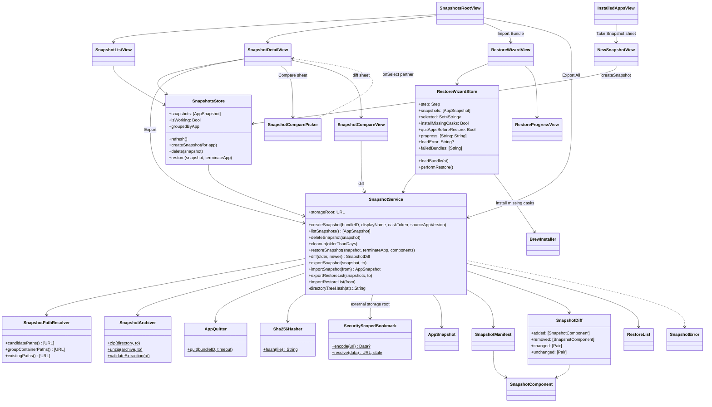
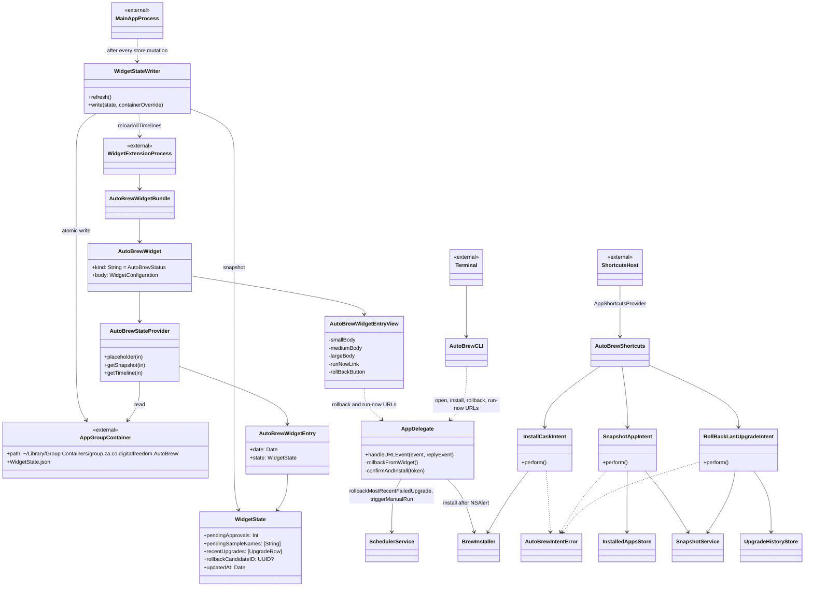
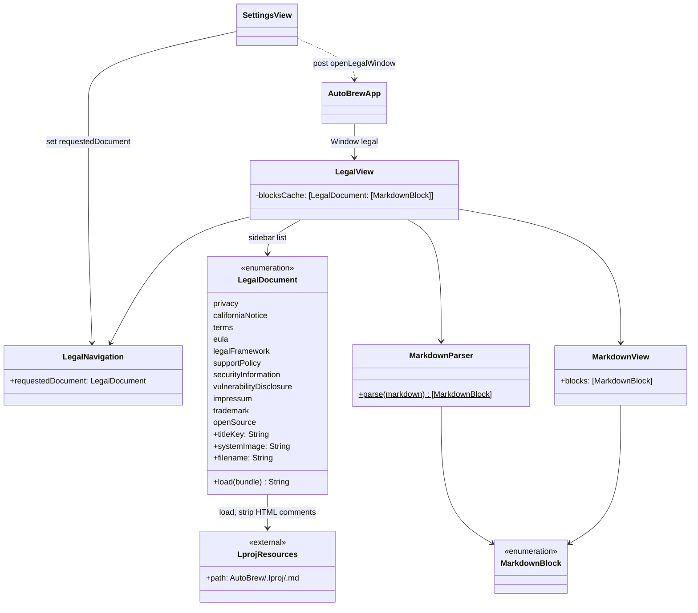
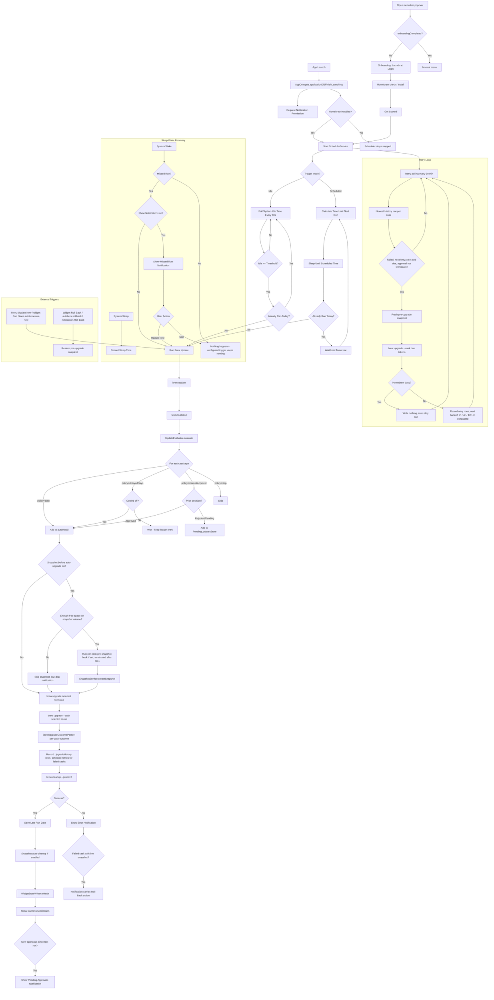
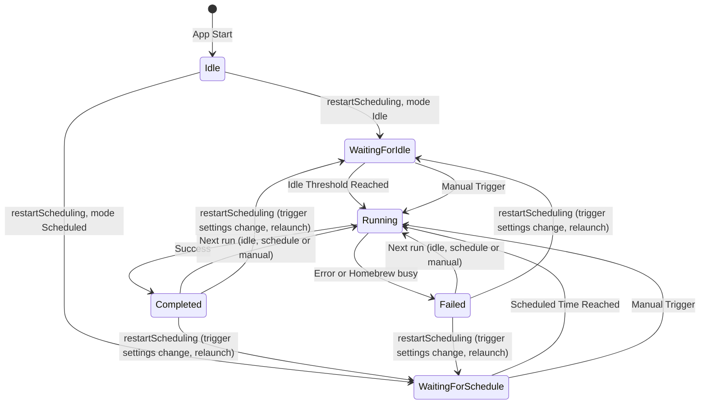

# AutoBrew

A native macOS menu bar app that automatically keeps Homebrew and all installed packages up to date — silently, in the background.

> **Safe by design.** When you install AutoBrew via the official channels — the DMG from [GitHub Releases](https://github.com/marcelrgberger/auto-brew/releases) or `brew install --cask autobrew` from the Homebrew tap — every release is built with Apple's Developer ID certificate, notarized by Apple, and stapled before it ships. macOS Gatekeeper accepts AutoBrew without warnings. The auto-update channel is signed with an EdDSA Ed25519 key — AutoBrew refuses to install an update whose signature doesn't verify. Source is open under the MIT License, no telemetry, no AutoBrew backend, no account — everything runs locally on your Mac.

## Install — Homebrew (recommended)

```bash
brew tap marcelrgberger/tap
brew install --cask autobrew
```

Other ways to install (manual DMG, requirements) are covered in the [Install](#install) section below. The cask submission to the official [`Homebrew/homebrew-cask`](https://github.com/Homebrew/homebrew-cask) catalog is prepared under [`docs/homebrew-cask-submission/`](docs/homebrew-cask-submission/SUBMISSION.md) — once merged upstream, the recommended install reduces to `brew install --cask autobrew` without the `brew tap …` line.

Release notes for every version live in [CHANGELOG.md](CHANGELOG.md) — the same body is shown in Sparkle's update dialog and on the GitHub release page.

## Table of Contents

- [Features](#features)
- [Quick Start](#quick-start)
- [User Guide](#user-guide)
  - [First Launch](#first-launch)
  - [The Menu Bar](#the-menu-bar)
  - [Choosing an Update Trigger](#choosing-an-update-trigger)
  - [Configuring the Update Policy](#configuring-the-update-policy)
  - [Pending Approvals](#pending-approvals-workflow)
  - [Browsing & Installing Casks](#browsing--installing-casks)
  - [Searching the Catalog](#searching-the-catalog)
  - [Managing Installed Apps](#managing-installed-apps)
  - [Creating an App Snapshot](#creating-an-app-snapshot)
  - [Restoring a Snapshot](#restoring-a-snapshot)
  - [Automatic Pre-Upgrade Snapshots](#automatic-pre-upgrade-snapshots)
  - [Update History & One-Click Rollback](#update-history--one-click-rollback)
  - [Doctor](#doctor)
  - [Orphans](#orphans)
  - [Collections](#collections)
  - [Shortcuts, Siri and Spotlight](#shortcuts-siri-and-spotlight)
  - [`autobrew` CLI](#autobrew-cli)
  - [Desktop & Notification-Center Widget](#desktop--notification-center-widget)
  - [Migrating to Another Mac](#migrating-to-another-mac)
  - [URL Scheme & Deep Links](#url-scheme--deep-links)
  - [Notifications](#notifications)
  - [Settings Overview](#settings-overview)
  - [Languages](#languages)
  - [Legal Window](#legal-window)
- [BrewStore](#brewstore)
  - [Discover & Browse](#discover--browse)
  - [Global Search](#global-search)
  - [Updates](#updates)
  - [Sidebar Overview](#sidebar-overview)
  - [Installed](#installed)
  - [Snapshots](#snapshots)
  - [Update History](#update-history)
- [Selective Update Policy](#selective-update-policy)
  - [Defaults](#defaults)
  - [Per-Package Overrides](#per-package-overrides)
  - [Pending Approvals](#pending-approvals)
  - [Cool-off Tracking](#cool-off-tracking)
- [Install](#install)
- [Requirements](#requirements)
- [Setup (Developers)](#setup-developers)
- [CI / Release Pipeline](#ci--release-pipeline)
- [Architecture](#architecture)
- [Project Structure](#project-structure)
- [Tests](#tests)
- [Security & Data Integrity](#security--data-integrity)
- [Support](#support)
- [License](#license)

## Features

- **Automatic Updates** — Runs `brew update → policy gate → selective brew upgrade → brew cleanup` once daily
- **Selective Update Policy** — Per-bump-type and per-package rules: patches roll out fast, minors wait a configurable cool-off, majors require explicit approval
- **Pre-Upgrade Auto-Snapshots** — Before every auto-installed cask upgrade, AutoBrew snapshots the app's user data so a broken update can be rolled back with one click from the new History view
- **Update History, Rollback & Auto-Retry** — Every auto-upgrade is logged with a per-cask outcome; rows with a live snapshot roll back in one click (optionally per component), and failed cask upgrades retry automatically after 1 h, 4 h and 12 h (at most three retries, decided by the newest attempt per cask)
- **BrewStore** — Full Homebrew cask catalog with Discover sections, curated categories, global search, download size before install, installed-app management and inline GitHub release notes for pending approvals
- **AppSnapshot** — Capture, restore, compare and export an app's user data; migrate a whole Mac with an `.autobrewbundle`; optionally store snapshots on an external drive
- **Collections, Doctor, Orphans** — Install or uninstall named sets of casks in one go, read `brew doctor` findings grouped by severity, and remove orphaned formulae
- **Pre-Snapshot Hooks** — Optional per-cask shell command that runs right before the pre-upgrade snapshot
- **Disk-Pressure Guard** — Skips the pre-upgrade snapshot when the snapshot storage volume is below a configurable free-space threshold
- **Shortcuts, Siri and Spotlight** — Install Cask / Snapshot App / Roll Back Last Upgrade actions via the system AppIntents framework
- **Desktop & Notification-Center Widget** — Status widget in three sizes (Small / Medium / Large) with pending-approval count, recent upgrade outcomes, a Run Now link and a one-tap roll back for the latest failed cask
- **`autobrew` CLI & URL Scheme** — `autobrew open / install / rollback / run-now` from the terminal, relayed through the `autobrew://` URL scheme
- **In-App Legal Section** — Eleven documents (Privacy Policy, California Notice at Collection, Terms of Use, EULA, Legal Framework Overview, Support and Update Policy, Security Information, Vulnerability Disclosure, Imprint, Trademark, Open-Source Licenses) in a dedicated Legal window
- **Idle-Based Trigger** — Waits for configurable idle time before running (default: 30 min)
- **Scheduled Trigger** — Alternatively, run at a fixed time of day
- **Works While Locked** — Uses IOKit idle detection, independent of screen lock state
- **Missed Run Recovery** — If the Mac was asleep during a scheduled run, prompts the user on wake
- **Outdated Package List** — Shows outdated formulae and casks with current and available versions
- **Homebrew Auto-Install** — Installs Homebrew automatically if not present (guided onboarding)
- **Login Item** — Starts automatically with the system via SMAppService
- **Auto-Updates** — Keeps itself up to date via Sparkle
- **8 Languages** — English, German, French, Italian, Dutch, Polish, Portuguese (Brazil), Spanish

## Quick Start

1. Install AutoBrew via Homebrew: `brew tap marcelrgberger/tap && brew install --cask autobrew`
2. Launch AutoBrew once from `/Applications`. The mug icon appears in the menu bar.
3. If Homebrew isn't on your Mac yet, the onboarding screen installs it for you.
4. Grant the notification permission when prompted — it's how AutoBrew tells you when an update needs approval.
5. Click the menu-bar mug → **Settings…** to pick a trigger mode (Idle or Scheduled) and review the default update policy.
6. That's it — AutoBrew runs in the background. Open it any time from the menu bar to inspect outdated packages, browse the BrewStore, or review pending approvals.

## User Guide

A walkthrough of every feature, in the order you'd typically encounter them.

### First Launch

On every launch AutoBrew asks for the **notification permission** (macOS shows the prompt only once). AutoBrew uses local notifications for completion, missed-run, pending-approval and low-disk alerts; they're never sent over a network.

The first time you open the menu-bar popover it shows a three-step onboarding flow instead of the normal menu:

1. **Welcome** — a **Launch at Login** toggle, on by default. Wires up `SMAppService` so AutoBrew restarts automatically with macOS. You can change it later in Settings.
2. **Homebrew check** — if `brew` is missing, the onboarding offers to run the official installer non-interactively (`NONINTERACTIVE=1 /bin/bash -c "$(curl -fsSL https://raw.githubusercontent.com/Homebrew/install/HEAD/install.sh)"`). An install error is shown inline with a **Try Again** button.
3. **Done** — **Get Started** marks onboarding as completed and starts the scheduler.

Onboarding only runs once (the `onboardingCompleted` flag in the preferences). To re-trigger it manually, remove `~/Library/Preferences/za.co.digitalfreedom.AutoBrew.plist` and relaunch.

### The Menu Bar

Clicking the mug icon opens a compact popover:

- **Status** — idle / waiting / scheduled / running stage / completed / failed, plus the time of the last run.
- **Outdated list** — up to five outdated packages with current → new version, and a "+ N more" line.
- **Update Now** — runs the full `brew update → policy gate → upgrade → cleanup` pipeline immediately.
- **Check Outdated Packages** — refreshes the list via `brew outdated`.
- **Show Log** — the output of the last run (only shown once there is output).
- **BrewStore** — opens the BrewStore window.
- **Settings…** — Settings and the log open as pages inside the popover rather than as separate windows.
- The detected `brew` path (or "Homebrew not installed") and **Quit**.

Next to the mug the icon shows one small badge. While a run is in progress, after it completed and after it failed, that is a status symbol (rotating arrows, checkmark, exclamation mark); the completed or failed badge stays until the next run starts or the scheduling restarts (a change to the trigger settings, or a relaunch). Only when no such status is shown does a small orange dot signal updates waiting for approval.

Seven days and again 90 days after the first launch, the popover shows a one-time sheet asking whether you'd like to star the repository or sponsor the project. Postponing dismisses that stage; confirming that you already support the project stops the prompts for good.

### Choosing an Update Trigger

Settings → **Update Trigger** picks how AutoBrew decides to run:

- **Idle mode** (default) — polls system idle time every 60 s and starts a Brew run after the user has been idle for at least `N` minutes (configurable, default 30). Runs at most once per calendar day. Idle detection reads `HIDIdleTime` from `IOHIDSystem` via IOKit, so it works even while the screen is locked.
- **Scheduled mode** — runs at a fixed time of day (configurable). If the Mac was asleep at the scheduled time, AutoBrew triggers a missed-run notification on wake instead of silently skipping.

Switch between modes at any time. The scheduler restarts cleanly when you do.

### Configuring the Update Policy

Settings → **Update Policy** has six pickers (patch / minor / major × Casks / Formulae) plus per-package overrides. Each picker accepts one of four policies:

| Policy | Behaviour |
|---|---|
| **Auto** | Install on the next scheduled run. |
| **Wait N days** | Install only after the new version has been visible for at least `N` days. Cool-off resets when a newer version supersedes the pending one. |
| **Ask me** | Don't install — surface the update in the Pending Approvals section instead. |
| **Skip** | Never install for this bump type. |

The default profile is conservative: patches roll out quickly, minors get a cool-off window, majors always wait for the user. Defaults differ between Casks and Formulae because Formulae carry security patches more often.

For one specific package, open it in the BrewStore detail view and click **Update Policy**. The override sheet lets you set patch/minor/major independently; leaving a row on **Default** inherits the global setting. The same sheet also carries an optional **Pre-snapshot command** (`/bin/bash -c <command>`) that runs right before the pre-upgrade snapshot of this cask — handy for flushing in-memory app state (`osascript`-driven saves, daemon quits, etc.). The command runs with your user permissions; the UI carries a clear warning that you should only paste commands you can read end-to-end. A command still running after 30 seconds is stopped together with every process it started (it runs in its own process group: SIGTERM first, SIGKILL 2 seconds later); its output is discarded (sent to `/dev/null`, not captured or logged), and a non-zero exit, a timeout or a launch failure is only logged — the snapshot and the upgrade go ahead either way.

### Pending Approvals Workflow

Major updates (and anything where the version string isn't parseable enough to classify) land in the **Pending Approvals** queue:

1. AutoBrew detects the update during a Brew run.
2. The menu-bar icon shows a small orange dot — unless a run status badge (running / completed / failed) currently takes its place, see [The Menu Bar](#the-menu-bar).
3. After a successful run, if the number of pending approvals grew compared with before the run, a single notification fires (`X updates need approval (Package A, B, …)`). Failed runs and runs that add nothing new stay silent.
4. Click **Review** on the notification, or open BrewStore → **Pending Approvals**.
5. Per row: **Approve** (queues for the next run), **Reject** (sticky — won't ask again until a newer version arrives), or use the toolbar **Approve All** / **Reject All**.

Once approved entries actually install during the next scheduler run, they are removed from the queue automatically. An approval stays in the queue until its upgrade succeeds, so a failed run or a busy Homebrew does not make you approve again; a successful automatic retry or a manual upgrade from the Installed tab also clears it. Undoing or rejecting an approval while a run is still preparing keeps that package out of the run.

**Release notes inline.** When the cask's homepage points at a `github.com/<owner>/<repo>` repository, AutoBrew fetches the GitHub release notes for the incoming version and shows them as an expandable section directly under the row. A lookup tries `releases/tags/v<version>`, then `releases/tags/<version>`, then `releases/latest`, so a cold lookup can cost up to three unauthenticated GitHub API requests per cask. A successful result is cached per cask (in memory and on disk) for 7 days, which keeps repeat visits off the network; failed lookups are not cached and are tried again next time, so a long approval list can still run into GitHub's unauthenticated rate limit (60 requests per hour).

### Browsing & Installing Casks

BrewStore → **Discover** shows App-Store-style sections (Top Ranked, plus categories like Browsers, Developer Tools, Productivity, …) sorted by 365-day install popularity from the public Homebrew analytics.

- Click any tile to see the cask's description, version, homepage, and the per-package Update Policy button.
- The detail view also shows the **download size** for the DMG by issuing a single HTTP HEAD against the cask URL when the view opens — a real number for most casks, "Download size unknown" when the server hides `Content-Length` or refuses HEAD. Sizes are cached in memory for the rest of the session so reopening the same detail view stays instant.
- Click **Install** to run `brew install --cask <token>` directly. In the detail view the button stays **Install**; the rows in Discover, categories and search results show **Open** instead once the app is on disk.
- Hover any row to see the full description (and the brew token for `@variant` casks).

### Searching the Catalog

The search field in the sidebar searches the **entire** cask catalog as soon as you type — across name, description, token, and the variant-decorated presentation name. The detail pane switches to a global Search Results view; clearing the field returns you to whichever section you were on. Results are sorted by install popularity so the most likely match floats to the top.

### Managing Installed Apps

BrewStore → **Installed** lists every `.app` in `/Applications` and `~/Applications` (Apple system apps filtered out). Each row shows the bundle ID, version, and — when applicable — the brew token managing the app.

How AutoBrew decides whether to show brew actions:

- It runs `brew info --cask --json=v2 --installed` once per refresh to learn what brew is **actually** tracking, including custom-tap installs.
- An app is marked as brew-managed only when the resolved token appears in that authoritative set. Manually installed apps stay unmanaged — no broken Upgrade/Uninstall buttons.

Per row (`⋯` menu):

- **Take Snapshot** — always available.
- **Upgrade via Brew** / **Uninstall via Brew** — only when brew is tracking the cask.

### Creating an App Snapshot

A snapshot is a point-in-time copy of the app's user data in a fixed set of standard `~/Library` locations (see [What gets captured](#what-gets-captured)). Use one before a risky upgrade, before migrating to a new Mac, or before deleting an app you might miss.

1. BrewStore → **Installed** → the app's `⋯` menu → **Take Snapshot**. (The Snapshots section itself has no create button; its empty state points you to the Installed tab.)
2. A confirmation sheet shows the app's name and bundle ID; click **Create Snapshot**. Creation does not quit the app, so quit it yourself first if it might be writing to disk.
3. AutoBrew copies the readable content of those locations, hashes each component with SHA-256, and writes a `manifest.json` next to the components. Inside a directory component, entries macOS refuses to hand over (e.g. `.com.apple.containermanagerd.metadata.plist` inside `Library/Containers/`), entries that vanish while the folder is being listed, and symlinks are skipped, so the snapshot can be **partial** — it still succeeds and gets an ID; the skipped content is simply not in it. A file that disappears in the moment it is being copied, and any other non-permission I/O error, aborts the snapshot; a snapshot that ends up with no components at all is rejected. The top-level paths themselves (e.g. the preferences `.plist`) are not checked for being symlinks.
4. The snapshot appears in the Snapshots list with the timestamp and size.

To free disk space later, either delete individual snapshots in the Snapshots view or enable Settings → **Auto-clean up old snapshots** with a retention window (default 90 days).

**External storage.** Settings → Snapshots → **External storage** opens a folder picker — typically for an external drive or NAS mount. New snapshots are then written to `<chosen folder>/AutoBrew/Snapshots/`. AutoBrew stores the choice as a security-scoped bookmark so the same folder is found again after unplug/replug (a stale bookmark is refreshed automatically). The storage location is resolved once per app session, the first time AutoBrew touches snapshot storage — relaunch AutoBrew after choosing a new folder to be sure it is used. If the volume isn't mounted at that moment, AutoBrew silently falls back to the default `~/Library/Application Support/AutoBrew/Snapshots/`. Settings → Snapshots → **Open in Finder** opens the location snapshots are actually written to in the current session — the external folder when it was reachable when storage was resolved, otherwise the default path. The **×** button next to the folder resets to the default location.

### Restoring a Snapshot

1. Open the snapshot in the Snapshots view.
2. Click **Restore**.
3. AutoBrew re-verifies every component hash recorded in the manifest before touching disk; mismatch → restore aborts.
4. The currently installed user-data is renamed to a hidden sibling `.<name>.autobrewbackup-<8-character UUID prefix>` (atomic on the same volume). If anything goes wrong after, that backup is moved back into place.
5. The snapshot content is copied into the target paths.
6. Hashes are recomputed on the written files. A second mismatch triggers the rollback path.
7. On success the temporary backup siblings are removed.

The restore is designed to be all-or-nothing, but on a best-effort basis: components are processed one after another, and if a step fails AutoBrew moves every backup it made back into place. If moving a backup back fails too (for example because the disk filled up), the backup is left next to the original path and its location is written to the app's standard error output for manual recovery; leftover backups after a successful restore are removed without checking for errors. You can opt out of the "quit the app first" step, but that risks data corruption if the app is mid-write.

### Automatic Pre-Upgrade Snapshots

Whenever AutoBrew auto-installs a cask upgrade (the **Auto** policy bucket — patches by default, anything else once its cool-off elapses), it can snapshot the cask's user data right before `brew` rewrites the `.app`. If the upgrade breaks your settings, you roll back in one click from the History view.

The toggle is in Settings → Snapshots → **Snapshot apps before auto-upgrade** and is on by default. Turn it off if you'd rather spare the disk space than keep the rollback affordance.

Per cask in the auto-install bucket:

1. AutoBrew resolves the cask token to a bundle ID via the same Installed Apps reconciliation BrewStore uses (catalog appName lookup, cross-checked against `brew info --cask --json=v2 --installed`).
2. `SnapshotService.createSnapshot` runs against that bundle's user-data folders before `brew upgrade` is invoked.
3. A new row is appended to `~/Library/Application Support/AutoBrew/UpgradeHistory.json` with the cask, the from/to versions, and the snapshot's UUID.

Failures never block the upgrade. Skipped content is not a failure: unreadable or permission-denied files inside a component are left out and the (partial) snapshot still gets an ID. A History row **without** a snapshot ID appears only when no snapshot was created at all — CLI-only casks or apps that don't live in `/Applications`/`~/Applications` (no bundle ID), the disk-pressure skip, a snapshot with no readable components, or another error that aborted it — the audit trail stays complete, just without a rollback button on that row. The snapshot itself follows the normal storage and retention rules, so the auto-cleanup window prunes it like any other snapshot.

**Disk-pressure awareness.** Before each pre-upgrade snapshot AutoBrew checks the free space on the volume that holds the snapshot storage — the home volume by default, the external drive when external storage is in use. When it has less than the configured threshold (default 10 GiB, adjustable from 1 to 100 GiB) free, AutoBrew skips the pre-upgrade snapshot for that cask and — if **Show Notifications** is on — surfaces a notification telling you which cask and why. The upgrade still runs — better than risking a near-full disk and breaking unrelated apps. If macOS can't report the free space (some network mounts), the check is skipped and the snapshot is attempted. Tune the threshold in Settings → Snapshots.

**Snapshot diff viewer.** From any snapshot's detail pane, the **Compare…** button opens a picker of other snapshots for the same bundle id (newest-first). Pick one and AutoBrew renders a side-by-side diff of the two manifests — added / removed / changed components with size deltas (negative when something shrank). The diff is computed entirely from the manifest's SHA-256 hashes, so it stays fast even on multi-GB snapshots and never touches the live filesystem.

### Update History & One-Click Rollback

BrewStore → **History** lists every cask AutoBrew has auto-upgraded, newest first, with the from/to versions, when it ran, and a per-cask status icon — green check for casks brew confirmed upgraded, red cross for casks that emitted an explicit `Error:` line during their upgrade, and an orange question mark when brew completed but did not emit either marker for that particular cask (the snapshot and rollback are still valid in that case). The per-cask attribution comes from a dedicated parser of `brew upgrade --cask`'s output so an aggregate brew exit status no longer paints every cask in a batch with the same brush.

When the pre-upgrade snapshot still exists on disk, a **Roll Back** button appears next to the row:

1. Click **Roll Back**.
2. A sheet opens with the snapshot's components (Preferences, Containers, Application Support, Caches, Saved State, Group Containers) listed as checkboxes with their sizes. Untick anything you want to leave at its current live state — handy when you only want to revert Preferences without flattening the Cache. The default is "everything selected" so a hit on **Roll Back** without unticking matches the old all-or-nothing behaviour.
3. AutoBrew quits the app, then restores the selected components from the snapshot — the upgraded `.app` binary itself **stays in place**, only the selected user-data folders revert.
4. The restore runs through the same backup-and-rollback path described in [Restoring a Snapshot](#restoring-a-snapshot), so a failure mid-way moves the backups of every selected component back (best effort, as described there).

If a row says **Snapshot pruned** instead, the snapshot was removed by retention (or by you in the Snapshots view) and the History row is now audit-only. The row itself never disappears just because the snapshot did — the history of what was auto-upgraded is kept indefinitely.

**Automatic retry with backoff.** A red History row is not the end of the story. When `brew upgrade --cask <token>` fails inside an auto-update run, AutoBrew schedules an automatic retry of just that cask on a backoff schedule of **1 h → 4 h → 12 h** — up to three attempts. A 30-minute polling task scans the History for due retries, captures a fresh pre-upgrade snapshot for each, and re-runs the upgrade. Only the **newest** History row of each cask counts: a cask is retried only when its latest attempt failed and that row's retry time has passed (an exhausted budget leaves the row without a retry time) — so a later success (automatic, retry or manual) ends the retries, and older failed rows never trigger an extra run. A cask whose approval you undid or rejected is not retried. If Homebrew is busy with another AutoBrew operation, the run is skipped without writing History rows and the cask stays due for the next check. While a retry is pending the row carries an orange **Auto-retry in …** badge with the ETA; once the budget is used up the badge turns red and reads **Retries exhausted** — the 30-minute retry loop then leaves the cask alone. That does not block the cask elsewhere: the next scheduled or manual Brew run still evaluates it through the update policy like any other outdated package, and you can upgrade it yourself from BrewStore → **Installed** → **Upgrade via Brew**. This catches transient failures (mirror hiccups, brief network blips, a cask that briefly failed to fetch its DMG) without the user ever having to notice them.

**Rolling back straight from a failed-update notification.** When an auto-update run fails *and* the most recent failed cask still has a live pre-upgrade snapshot, the failure notification carries an extra **Roll Back** action. Tapping it runs the same restore the History view would, without needing to open AutoBrew first.

**Manual upgrades from BrewStore.** The same snapshot-then-upgrade-then-record pipeline now runs when you press **Upgrade via Brew** on a row in Installed, so manually-initiated upgrades also produce a History entry with a rollback affordance. A per-token in-flight guard rejects double-clicks so two snapshot+upgrade tasks can never race for the Homebrew lock.

### Migrating to Another Mac

Two flavours:

- **Single-app**: Snapshot detail → **Export…** writes a self-contained `.autobrewsnapshot` file (ZIP archive built with `ditto -c -k --sequesterRsrc` to preserve macOS extended attributes). Copy it to the target Mac and import it there via Snapshots → **Import Bundle**. (Double-clicking the file in Finder does not import it — AutoBrew registers no document type.)
- **Bulk**: Snapshots view → **Export All…** produces an `.autobrewbundle` directory with one `.autobrewsnapshot` for every saved snapshot (not one per app) plus a `restore_list.json` index. Copy the whole directory.

On the new Mac open the **Restore Wizard** (Snapshots → **Import Bundle**), point it at the `.autobrewsnapshot` or `.autobrewbundle`, pick which apps to restore, and AutoBrew:

1. Extracts each archive with `ditto`, then rejects any symlink or path that escapes the extraction folder, and validates the manifest (supported schema version, valid bundle ID, at least one component, no negative sizes). Component hashes are not checked at import; hashes recorded in the manifest are checked when the snapshot is restored.
2. With **Install missing casks** on (the default), runs `brew install --cask <token>` for each selected app that has a cask token; if that install fails, `brew search` by the app's display name looks for a renamed cask and installs that instead. If no install succeeds, that app's data restore is skipped.
3. Restores every imported snapshot of each selected app via the same backup-and-rollback flow as a local restore (optionally quitting it first — **Quit apps before restore**, on by default). Several snapshots of the same app are applied one after another; the last one applied wins.

### Doctor

BrewStore → **Doctor** runs `brew doctor` and parses the output into discrete findings, grouped by severity (errors first, then warnings). Each finding renders as a `DisclosureGroup` — the title up top, the full body (file paths, suggested fixes) one click away. The doctor runs automatically when the section opens only while there is no cached report yet in this session; later visits show the cached report, and **Run brew doctor** runs it again on demand. Unclassified noise from brew (the friendly "Your system is ready to brew." line, stray informational chatter) is filtered out so the list only shows actual findings.

### Orphans

BrewStore → **Orphans** runs `brew autoremove --dry-run` when the section opens while its cached list is empty (later visits show the cached list; **Refresh** probes again) to surface formulae that were pulled in as dependencies but whose parents are gone. **Remove All** runs the real `brew autoremove`, then runs the dry-run probe again so formulae that only became orphaned by that first pass (chain dependencies) show up in the list; removing them takes another click on **Remove All**. The list is intentionally formulae-only — `brew autoremove` never touches casks or anything you installed explicitly.

### Collections

BrewStore → **Collections** lets you define named sets of cask tokens — *Dev Setup*, *Gaming Setup*, *New Laptop* — and act on the whole set with one click.

- **Create** a collection from the sidebar's **+** button, give it a name, and add tokens individually in the detail view. Token grammar is validated against `^[a-zA-Z0-9][a-zA-Z0-9._-]*$` to keep typos out.
- **Install All** runs `brew install --cask` for every token in sequence, with a progress banner that tracks `<done>/<total>` and the cask currently being processed. A failure inside the batch doesn't abort the rest — failed tokens get collected and shown in an error alert after the run completes.
- **Uninstall All** does the same with `brew uninstall --cask`.
- **Export…** writes the collection as a single `.autobrewcollection` JSON file (Save panel from the row's context menu). **Import…** from the sidebar's tray button reads one back and adds it with a fresh UUID so it can't clobber an existing collection.

Collections live in `~/Library/Application Support/AutoBrew/Collections.json` alongside the other AutoBrew state.

### Shortcuts, Siri and Spotlight

AutoBrew exposes three system AppIntents so the snapshot/upgrade/rollback pipeline shows up in **Shortcuts.app**, can be invoked from **Siri**, and surfaces in **Spotlight** alongside other system actions:

| Intent | Phrase / Title | What it does |
|---|---|---|
| **Install Cask** | "Install a cask with AutoBrew" | Takes a cask token and runs `brew install --cask <token>` through `BrewInstaller`, same retry-with-`--force` and lock semantics as the BrewStore button. |
| **Snapshot App Data** | "Snapshot an app with AutoBrew" | Takes a cask token, resolves it to a bundle ID via the Installed Apps reconciliation, and runs `SnapshotService.createSnapshot`. Returns the snapshot UUID so the user can chain it into another shortcut. |
| **Roll Back Last Cask Upgrade** | "Roll back the last upgrade with AutoBrew" | Walks the History store newest-first for a failed cask with a live snapshot and runs the same backup-and-rollback restore as the History view. Optional cask-token parameter scopes the search to one cask. |

Tokens are validated against the same `^[a-zA-Z0-9][a-zA-Z0-9._-]*$` grammar the `autobrew://install/` URL scheme uses — defense in depth even though the cask token is never interpreted through a shell. Intents run with `openAppWhenRun = false` so a Shortcut from another app does not steal focus.

Known limitation: because AutoBrew sets `LSUIElement = true`, the system only discovers these intents after the menu-bar icon has been visible at least once. For users who already run AutoBrew that is automatic; brand-new installs need to launch the app once before the actions appear in Shortcuts.

### Desktop & Notification-Center Widget

AutoBrew ships a WidgetKit-based status widget. Add it from **System Settings → Desktop & Dock → Widgets**, or right-click the desktop and choose **Edit Widgets**, then drag the AutoBrew widget onto your desktop or into Notification Center.

| Size | What it shows | Tap behaviour |
|---|---|---|
| **Small** | Pending-approval count (or "Up to date"), updated-at footer. | Opens AutoBrew. |
| **Medium** | Pending count left + the three most recent auto-upgrade rows on the right (cask name, from→to, per-cask outcome icon). | Opens AutoBrew. |
| **Large** | Pending headline + the five most recent upgrades + a **Run Now** link plus a destructive **Roll Back Last Failed** link when a rollback candidate exists. | Run Now triggers an immediate `brew update → upgrade → cleanup` cycle in the host app (same reentrancy guard as the menu-bar manual-trigger). Roll Back uses the same restore path as the failed-upgrade notification. Surface tap opens AutoBrew. |

**Per-cask icons** match the History view: green check (brew confirmed the upgrade), red cross (brew emitted an error inside that cask's section), orange question mark ("outcome unclear — brew swallowed the per-cask signal but the snapshot and rollback are still valid").

**Where the data lives.** The widget reads from `~/Library/Group Containers/group.za.co.digitalfreedom.AutoBrew/WidgetState.json`, written by the main app whenever pending approvals or upgrade history mutate, plus once at the end of every **successful** scheduler run so the "Updated <relative>" footer stays current even on a no-op day. A run that fails before the pending-approvals list is rewritten (for example when `brew update` fails) does not refresh it, so the timestamp can stay at the previous update; once that list has been saved, the widget is refreshed even if the upgrade itself then fails. The widget extension is sandboxed; the App Group container is its only window into the main app's data.

**First-launch caveat.** Because AutoBrew sets `LSUIElement = true`, the widget only appears in the Add Widget picker after the menu-bar icon has been visible at least once.

### `autobrew` CLI

A thin terminal helper ships inside the app bundle at
`AutoBrew.app/Contents/Helpers/autobrew` and is symlinked into the
user's `PATH` by the Homebrew cask. `version` and `help` run locally
in the helper. The action commands (`open`, `install`, `rollback`,
`run-now`) build an `autobrew://` URL and hand it to
`NSWorkspace.open`, which launches AutoBrew if it is not running and
returns immediately — the helper exits successfully once the URL is
handed off and does not report whether the action itself succeeded.
`install` validates the token locally first, and the security checks
the URL handler enforces (cask-token grammar, NSAlert confirmation on
install) apply unchanged.

```bash
autobrew open                    # bring BrewStore forward
autobrew install firefox         # request an install, NSAlert confirms
autobrew rollback                # roll back the most recent failed cask
autobrew run-now                 # trigger an immediate update + upgrade
autobrew version                 # print bundled version
```

Direct service reuse (running snapshot creation from the CLI without
involving the GUI) is out of scope for this first iteration — it
would need its own event loop and file locking against the GUI's
`@MainActor` stores. The URL-relay design keeps the GUI as the
single writer to all on-disk state.

### URL Scheme & Deep Links

AutoBrew registers the `autobrew://` URL scheme:

- `autobrew://open` — bring the BrewStore window forward (works from Terminal, a browser link, or another app's automation).
- `autobrew://install/<cask-token>` — install a cask in the background. Tokens are validated against `^[a-zA-Z0-9][a-zA-Z0-9._-]*$` and a confirmation dialog appears before the install runs, so a malicious link can't silently install software.
- `autobrew://rollback` — trigger from the widget's Roll Back link. Runs the same newest-failed-with-live-snapshot rollback the failed-upgrade notification action uses.
- `autobrew://run-now` — trigger from the widget's Run Now link. Equivalent to the menu-bar Run-Now action; the SchedulerService's `pipelineInProgress` guard keeps double-clicks from queuing parallel runs.

### Notifications

AutoBrew uses four notification types:

- **Completion** — fires after every successful or failed Brew run. Body shows success / error detail. When the run failed and the most recent failed cask still has a live pre-upgrade snapshot, the notification carries a **Roll Back** action.
- **Missed-run** — fires after wake-from-sleep if the Mac was asleep during a scheduled run. Actions: **Update Now** (runs immediately) or **Skip** (nothing happens; the configured trigger keeps running). With **Show Notifications** off, a missed run is started immediately instead.
- **Pending approvals** — fires after a successful run when the pending-approval count increased during that run. **Review** opens BrewStore → Pending Approvals.
- **Low disk space** — fires when a pre-upgrade snapshot was skipped because the snapshot storage volume is below the free-space threshold. Names the cask, the free space and the threshold.

All four can be turned off globally in Settings → **Show Notifications**.

### Settings Overview

Settings opens as a page inside the menu-bar popover:

| Section | Controls |
|---|---|
| **Update Trigger** | Mode (After Idle / Scheduled Time), idle duration (5–120 min in 5-minute steps, default 30) or time of day (default 03:00). |
| **Update Policy** | Six patch / minor / major pickers for Casks and Formulae, each offering Auto, Wait 2 / 7 / 14 / 30 days, Ask me and Skip — see [Configuring the Update Policy](#configuring-the-update-policy). |
| **General** | **Launch at Login**, **Show Notifications** (default on). |
| **Snapshots** | **Snapshot apps before auto-upgrade** (default on), free-space threshold (1–100 GiB, default 10), **Auto-clean up old snapshots** (default off) with retention (7–365 days in 7-day steps, default 90), **Open in Finder** for the active snapshot location, **External storage** folder picker with reset. |
| **Icon Cache** | Size and last update of the on-disk cask icon cache, **Clear Icon Cache**. |
| **Homebrew** | Whether `brew` was found, and its path. |
| **Updates** | **Check for Updates** — triggers Sparkle manually. |
| **About** | Version, brand (DigitalFreedom), operator (DigitalFreedom Global LLC), links to Help & Support, Sponsor this Project and the source code. |
| **Legal** | One row per legal document; each opens the [Legal window](#legal-window) on that document. |

### Languages

AutoBrew ships in 8 languages: English, German, French, Italian, Dutch, Polish, Portuguese (Brazil), and Spanish. The active locale follows the macOS system language. All eleven legal documents ship in all 8 languages as Markdown files under `AutoBrew/<locale>.lproj/`; if a file were ever missing for a locale, macOS would fall back to the English version.

### Legal Window

Settings → **Legal** → \<document\> opens a separate **Legal** window (760 × 640 by default) with a sidebar listing all eleven documents and the selected document rendered on the right:

- Privacy Policy
- California Notice at Collection
- Terms of Use
- EULA
- Legal Framework Overview
- Support and Update Policy
- Security Information
- Vulnerability Disclosure
- Imprint
- Trademark
- Open-Source Licenses

The documents are rendered by AutoBrew's own small Markdown renderer (`MarkdownParser` / `MarkdownView`): headings, paragraphs, bullet and numbered lists, tables, horizontal rules and code fences; blockquotes are unwrapped into ordinary paragraphs and lists. HTML comments in the source files (maintenance notes) are stripped before display. Text in the Legal window is selectable.

## BrewStore

Starting with version 2.0.0, AutoBrew ships a full Homebrew GUI and an AppSnapshot engine.

### Discover & Browse
Full Homebrew cask catalog (`formulae.brew.sh`) organised as App-Store-style Discover sections plus ten hand-curated sidebar categories (Browsers, Developer Tools, Communication, Productivity, Media, Graphics & Design, Utilities, Security, Games, Cloud Storage), each ranked by 365-day install popularity. Every row has a hover tooltip with the full description and the brew token for `@variant` casks. Variants (`alfred`, `alfred@4`, `alfred@prerelease`) are decorated in the title — "Alfred", "Alfred 4", "Alfred (Prerelease)" — so they're never visually identical.

The catalog (~30 MB cask payload + ~17 MB analytics) is cached to disk on first fetch under `~/Library/Application Support/AutoBrew/Catalog/`. Subsequent refreshes are **conditional**: AutoBrew persists the server's `ETag` per endpoint and sends `If-None-Match` on the next fetch, so a refresh comes back as `304 Not Modified` when nothing changed upstream. There is no background timer: each time the BrewStore window's content loads, `BrewStoreWindow.loadCatalog()` loads the disk cache and refreshes from the network only when the last refresh is older than 24 hours (or never happened); when that refresh returns 304, the in-memory catalog stays untouched — only `lastRefresh` advances. ETags are saved only after the cache writes succeed, so a failed write forces a full re-download next time instead of trusting a 304 against a payload that never made it to disk.

### Global Search
The sidebar search field walks the entire cask catalog (token, name, description) regardless of which section is selected. Clearing the field returns the user to whatever they were looking at before.

### Updates
Lists every outdated formula and cask with current → available version, populated by `brew outdated` when the section opens; shows "All up to date" when nothing is pending. What actually gets installed is decided by the [Selective Update Policy](#selective-update-policy) on the next run.

### Sidebar Overview
Top section: **Discover**, **Installed**, **Snapshots**, **Updates**, **History**, **Collections**, **Orphans**, **Doctor**, and **Pending Approvals** (only while something is pending). Below it the ten categories, and at the bottom external links to **Help & Support** (https://support.apps.digitalfreedom.co.za), **Sponsor this Project** and **Source Code**.

### Installed
Scans `/Applications` and `~/Applications`, reconciles each `.app` bundle against `brew info --cask --json=v2 --installed` so:
- Apps installed manually (DMG, drag-to-Applications) show up without a cask token — no Upgrade/Uninstall buttons that would fail.
- Apps installed via a **custom Homebrew tap** are still tracked correctly (uses `full_token` instead of the public catalog).
- When several casks share the same `.app` (`alfred` vs `alfred@4`), the row reflects which cask brew is actually managing — not whichever the public catalog happened to list first.

Per app: create snapshot, upgrade via Brew, or uninstall.

### Snapshots

A snapshot is a point-in-time copy of an application's user data in a fixed set of standard `~/Library` locations derived from its bundle ID (listed below) plus its matching group containers. That is not everything an app may own: login items, Keychain entries, folders under Application Support that are not named after the bundle ID, and anything outside `~/Library` are not captured. For most apps, though, those locations are what makes an app "yours" after a fresh install. Without them, reinstalling Slack means re-signing in, reinstalling Visual Studio Code means losing every extension and setting, etc.

#### What gets captured

For each app, `SnapshotPathResolver` probes exactly these paths and copies the ones that exist:

| Path | Purpose |
|---|---|
| `~/Library/Preferences/<bundleID>.plist` | UserDefaults — settings, recent items, window positions |
| `~/Library/Application Support/<bundleID>/` | App-managed data — databases, projects, extensions |
| `~/Library/Containers/<bundleID>/` | App-Sandbox data (sandboxed apps store everything here) |
| `~/Library/Saved Application State/<bundleID>.savedState/` | Window restoration on next launch |
| `~/Library/Group Containers/<groupID>/` | Shared data between an app and its extensions — only containers whose name matches the bundle ID (full ID, reverse-domain prefix, or a long non-generic last segment) |
| `~/Library/Caches/<bundleID>/` | Caches — always included when present (there is no opt-out); a selective restore can leave them untouched |
| `~/Library/WebKit/<bundleID>/` | WebKit data of apps that embed web views |
| `~/Library/HTTPStorages/<bundleID>/` and `<bundleID>.binarycookies` | URLSession storage and cookies |
| `~/Library/Cookies/<bundleID>.binarycookies` | Legacy cookie store |

Snapshots created by AutoBrew record a **SHA-256 hash** for every file component and a tree hash for every directory component in the manifest. On restore every hash present in the manifest is recomputed and compared — a mismatch aborts the restore before your data is touched. The `sha256` field is optional in the manifest format, so a component of an imported manifest without a hash is restored without that check.

#### Storage on the source Mac

Snapshots live under `~/Library/Application Support/AutoBrew/Snapshots/` (or `<external folder>/AutoBrew/Snapshots/` when [external storage](#creating-an-app-snapshot) is set), one folder per snapshot. Each snapshot is a folder `<bundleID>/<timestamp>_<first 8 characters of the snapshot UUID>/`, so snapshots are grouped per app and sort chronologically. It contains a `data/` folder with the raw component copies plus a `manifest.json` with:

- App's bundle ID, display name, version at snapshot time
- Cask token (when AutoBrew can resolve it)
- Component list with paths, sizes, and hashes
- Snapshot creation timestamp

#### Restore flow

1. AutoBrew offers to **terminate the running app** (you can opt out — restore over a running app risks data corruption).
2. The current state of every component path is moved to a backup next to the original.
3. Components are copied from the snapshot into their target paths, one after another.
4. Hashes recorded in the manifest are recomputed on the written files. On a mismatch or any other error, the backups are moved back (best effort — a backup that cannot be moved back stays next to the original and its path is logged).
5. On success, the temporary backups are removed and the user can relaunch the app.

#### Cross-Mac migration

- **Single-snapshot export** — `.autobrewsnapshot` file: a ZIP bundle (created with `ditto -c -k --sequesterRsrc --keepParent` so extended attributes survive) containing the snapshot folder — the `data/` components plus `manifest.json`. Import it on another Mac via Snapshots → **Import Bundle** (there is no Finder double-click import), or attach it to a message.
- **Bulk export** — `.autobrewbundle` directory containing one `.autobrewsnapshot` for **every saved snapshot** (named `<bundleID>_<UUID prefix>.autobrewsnapshot`, so several snapshots of the same app are all included) plus a `restore_list.json` index. Use this when migrating a whole Mac; delete older snapshots first if you only want the newest one per app.
- **Restore wizard** — point AutoBrew at an `.autobrewsnapshot` or an `.autobrewbundle`:
  1. Each archive is extracted and checked: no symlinks or escaping paths, supported schema version, valid bundle ID, at least one component, no negative sizes. Hashes are not checked at this point — only on restore.
  2. You pick which apps (bundle IDs) to restore.
  3. With **Install missing casks** on, AutoBrew runs `brew install --cask <token>` for each selected snapshot that has a token; if that fails, `brew search` by the app's display name looks for a renamed cask and installs it instead. If no install succeeds, that snapshot's data restore is skipped.
  4. Every imported snapshot of a selected app is restored via the same backup-and-rollback flow as a local restore. If the bundle contains several snapshots of one app, they are applied one after another and the last one applied wins.

#### What snapshots don't capture

- Files outside the standard user-data locations (e.g. data dumped under `/Library/...` system-wide, or in custom-configured paths)
- App Store receipts (StoreKit re-verifies on first launch, so this normally just means signing in again)
- License keys stored in the macOS Keychain (Keychain isn't snapshotted — restore the app and re-enter the licence)
- A guaranteed-consistent state of files the app is writing while the snapshot runs. Creating a snapshot does not quit the app, and AutoBrew makes no attempt to detect or exclude files in use — quit the app first if you want a consistent copy (restoring, by contrast, offers to quit it).

#### How it works under the hood

`SnapshotService` is the entry point; it collaborates with three small helpers and a small amount of disk state:

- **`SnapshotPathResolver`** — given a bundle ID, returns every candidate user-data path that exists on disk (the table above). Lookups are cheap (file-existence checks only); paths that don't exist are skipped, so the manifest only carries real components. Group containers are matched by an identifying reverse-domain prefix plus a distinctive last segment (≥6 chars, not in the generic blocklist `.app/.mac/.ios/…`) — a previous "match anything containing the last segment" heuristic pulled in Apple's own group containers (e.g. `group.com.apple.stocks-news` matched `com.usebruno.app` because "apple" contains "app") and the tightened matcher closes that class of false positive.
- **`Sha256Hasher`** — streams a single file through `CryptoKit.SHA256` in 64 KB chunks, so even multi-gigabyte caches don't blow up memory. Directory components are hashed by `SnapshotService` itself (private `directoryTreeHash(at:)`), which walks the tree sorted by relative path and feeds each entry in with a length-prefixed binary encoding (8-byte big-endian path length → relative path → one kind byte for file or directory → for files, the 32-byte content digest from `Sha256Hasher`) so the hash is stable across runs as long as the contents and structure didn't change. Entries that are neither regular files nor directories (FIFOs, sockets, devices) abort the snapshot.
- **`SnapshotArchiver`** — wraps Apple's `ditto -c -k --sequesterRsrc` to ZIP/UNZIP. Using `ditto` instead of `zip` matters: it preserves macOS extended attributes (`com.apple.metadata:*`) and the resource fork on legacy files, which `zip` would silently drop. Symlinks inside directory components are skipped at creation (top-level component paths are not checked), and extraction on import rejects any archive that contains a symlink (`validateExtraction(at:)`).

**Create flow** (`SnapshotService.createSnapshot`):

1. Resolve all candidate paths via the resolver. If the set is empty after filtering, the snapshot is **rejected** — an empty snapshot is more dangerous than no snapshot (it would "restore" a wiped state).
2. Stream-copy each path into the `data/` subfolder of a fresh `<bundleID>/<timestamp>_<UUID prefix>/` folder under the snapshot storage root (`~/Library/Application Support/AutoBrew/Snapshots/` by default, or `<external folder>/AutoBrew/Snapshots/`). Directories are walked entry-by-entry; permission-denied files and vanished entries are skipped (so a single unreadable sibling doesn't abort the whole copy), every other enumeration error rethrows so a partial component can never claim to be complete.
3. Compute the SHA-256 for each component (file → file hash, directory → tree hash).
4. Write `manifest.json` last (a plain `Data.write(to:)`, not an atomic write). If the process is killed before this step, the folder has no manifest and is ignored by the snapshot list — it is never offered for restore.

**Restore flow** (`SnapshotService.restoreSnapshot(_:terminateApp:components:)`). When `components` is passed (the selective Roll Back sheet), only those component paths are restored and an empty selection is rejected; `nil` restores everything.

1. If `terminateApp` is set, quit the app via `AppQuitter` — polite `terminate()` first, then `forceTerminate()` after `timeout` seconds; cancellable.
2. Re-verify every selected component that has a hash in the manifest, and reject any component whose target path would escape `$HOME` (`decodeOriginalPath` — a lexical check on the standardized path string; it does not resolve symlinked parent directories in the live home folder). Mismatch → abort with `SnapshotError.invalidManifest("Hash mismatch …")` before anything on disk is touched.
3. For every component path, the current state is renamed to a hidden sibling `.<name>.autobrewbackup-<8-character UUID prefix>` in the same folder (zero-copy, atomic on the same filesystem). At this point the original is staged for cleanup but still recoverable.
4. The snapshot version is copied into the target path.
5. Hashes are recomputed on the **written** files and compared against the manifest. Any mismatch triggers the rollback step.
6. On success, the `.autobrewbackup-*` siblings are deleted (`try?` — a backup that cannot be deleted is silently left behind). On failure, each backup is renamed back over its path after removing the partial write (`rollbackBackup`, newest first); if that rename fails, the backup stays where it is and a `BACKUP STRANDED at …` line is written to standard error. The rollback is best effort, not an atomic transaction.

**Auto-cleanup** (Settings → Snapshots → "Auto-clean up old snapshots"): after every successful Brew run, `SnapshotService.cleanup(olderThanDays:)` walks the snapshot folder and removes any folder whose `manifest.json` creation timestamp is older than the configured retention window (default 90 days). Snapshots without a parseable manifest are left alone — we'd rather keep orphans than delete by guess.

**Pre-upgrade snapshots** (`SchedulerService.capturePreUpgradeSnapshots`): immediately before `BrewManager.runUpgrade`, for every cask in the auto-install bucket, the scheduler resolves the cask token to a bundle ID via `InstalledAppsStore` (the same lookup BrewStore uses for the Installed view; the store is lazy-refreshed if it's empty), calls `createSnapshot`, and records the snapshot's UUID alongside the upgrade in `UpgradeHistoryStore` (file-backed in `~/Library/Application Support/AutoBrew/UpgradeHistory.json`, newest first, kept indefinitely — `UpgradeHistoryStore.prune(olderThanDays:)` exists but is not called, so only the snapshots age out). Failure modes are deliberately non-blocking. Permission-denied content inside a component is skipped; as long as some readable content remains, the snapshot succeeds and the History row gets its snapshot ID. A cask without an installed `.app` (no bundle ID), the disk-pressure skip, a snapshot with no readable components, or any other snapshot error is logged and the upgrade still runs; the History row is then written without a snapshot ID so the audit trail stays complete. The pass honours `Task.isCancelled` between casks so a scheduler restart (mode change, app quit) doesn't keep snapshotting after the user has moved on.

`recordUpgradeHistory` writes one row per cask after `runUpgrade` returns. `BrewManager.runUpgrade` returns a per-cask `CaskUpgradeOutcome` (`succeeded` / `failed` / `attempted`) produced by `BrewUpgradeOutcomeParser` from `brew upgrade --cask`'s output; a cask the parser could not attribute is recorded as `attempted` (the orange question mark), and if the whole upgrade call threw, every cask in the batch is recorded as `failed`. For a `failed` row, `computeRetryState` (→ `UpgradeHistoryEntry.retryState`) carries the retry count over from the cask's newest earlier row only if that row also failed, then sets `retryCount` and `nextRetryAt` from the backoff schedule (`backoffSchedule`: 1 h, 4 h, 12 h; `maxRetries = 3`). Once the budget is spent, `nextRetryAt` is `nil` and the row is sticky-failed ("Retries exhausted"); `succeeded` and `attempted` reset the counter. A 30-minute polling task (`startRetryPolling` → `runRetryDuePass`) asks `UpgradeHistoryEntry.retryCandidates(in:now:)` for due rows — it keeps only the newest entry per token (`latestPerToken`; the store is newest-first) and then requires `outcome == .failed` and a non-nil `nextRetryAt <= now`. It does not compare `retryCount`; the exhausted budget is expressed by `nextRetryAt == nil` (the third retry's row legitimately carries `retryCount == 3`). Casks whose pending approval was withdrawn (undone or rejected) are filtered out. The pass then takes a fresh pre-upgrade snapshot and re-runs only those casks; `recordRetryHistory` writes the new rows. When Homebrew is busy with another AutoBrew operation, `BrewManager.runUpgrade` throws `BrewError.busy`: the scheduled run then writes **no** History rows and is not marked as done (it fails; in idle mode the next idle check runs it again, in scheduled mode the next scheduled time does), and a busy retry pass writes nothing and leaves the rows due for the next 30-minute check. Older `UpgradeHistory.json` files that still carry `succeeded: Bool` are decoded into the new `outcome` field.

**Export** (`SnapshotService.exportSnapshot`) zips the snapshot folder with `ditto` to the location picked in the save panel, which suggests `<bundleID>.autobrewsnapshot`; an existing file at that path is replaced. The manifest travels inside the archive, so the file is self-describing.

**Import** (`SnapshotService.importSnapshot`) extracts the `.autobrewsnapshot` with `ditto` into a temporary `_import_<UUID>` folder under the storage root, then runs `SnapshotArchiver.validateExtraction` — any symlink or any path resolving outside the folder deletes the extraction and aborts. It then validates the manifest (present, supported schema version, valid bundle ID, at least one component, no negative sizes) and moves the folder to `<bundleID>/<timestamp>_<UUID prefix>/`. Component hashes are **not** recomputed at import; the restore flow verifies them before anything is written. The snapshot keeps its manifest `id`: importing the same snapshot again replaces the existing copy at that path (the old copy is moved aside and only deleted once the new one is in place). A `.autobrewbundle` is imported by `importRestoreList`, which checks each `archiveFilename` (no path separators or `..`, must end in `.autobrewsnapshot`) and imports every archive the same way.

### Update History
Audit log of every cask AutoBrew auto-upgraded — token, display name, from/to versions, timestamp, and the pre-upgrade snapshot ID when one was taken. Each row that still has its snapshot on disk shows a **Roll Back** button that restores the cask's user data via the same backup-and-rollback path as a manual restore, without touching the upgraded `.app` itself. Rows whose snapshot has aged out of the retention window flip to a **Snapshot pruned** label and become audit-only. The full workflow is described in the [Update History & One-Click Rollback](#update-history--one-click-rollback) section of the User Guide.

### URL Scheme
- `autobrew://open` — open the main window.
- `autobrew://install/<cask-token>` — install a cask in the background (token validated against `[a-zA-Z0-9][a-zA-Z0-9._-]*`).

### Auto-Cleanup
In Settings: automatically remove old snapshots after N days (default 90). Cleanup runs after each successful Brew update.

## Selective Update Policy

AutoBrew classifies each pending update as **patch**, **minor**, or **major** (based on SemVer parsing) and routes it through one of four policies:

| Policy | Behaviour |
|---|---|
| **Auto** | Install on the next scheduled run |
| **Wait N days** | Install once the version has been available for at least N days |
| **Ask me** | Stay in the "Pending Approvals" list until the user approves or rejects |
| **Skip** | Never install for that bump type |

### Defaults

Conservative starter values picked so security patches land fast while breaking changes stay opt-in:

|  | Casks | Formulae |
|---|---|---|
| Patch | Wait 2 days | Auto |
| Minor | Wait 14 days | Wait 7 days |
| Major | Ask me | Ask me |

Configure in **Settings → Update Policy**.

### Per-Package Overrides

Open any cask in the BrewStore detail view and click **Update Policy** to set patch/minor/major rules just for that package. Leave a row on "Default" to inherit the global setting.

### Pending Approvals

Major updates (and anything classified as `unknown` because the version string isn't SemVer-shaped) wait for the user. They show up in:
- **BrewStore → Pending Approvals** — sidebar entry only appears when there's something pending
- **Menu bar icon** — small orange dot (hidden while a running / completed / failed badge is shown)
- **Notification** — fires once when the pending count grows; tapping it opens the approvals view directly

Rejected entries stay sticky until a newer version arrives, so you're not re-asked about the same major release on every scan.

### Cool-off Tracking

A small JSON ledger in `~/Library/Application Support/AutoBrew/UpdateLedger.json` records when each `(kind, token, version)` first appeared as outdated. The "Wait N days" policy measures the window from that first sighting, not from each scan, so multiple scheduler runs don't reset the timer.

## Install

### Via Homebrew (recommended)

```bash
brew tap marcelrgberger/tap
brew install --cask autobrew
```

### Manual Download

Download the latest DMG from [GitHub Releases](https://github.com/marcelrgberger/auto-brew/releases), open it, and drag AutoBrew to your Applications folder.

The app is signed and notarized by Apple — no Gatekeeper warnings.

## Requirements

AutoBrew runs on every macOS release from Sonoma onward:

| macOS | Version | Year | Status |
|---|---|---|---|
| Sonoma | 14 | 2023 | Supported |
| Sequoia | 15 | 2024 | Supported |
| Tahoe | 26 | 2025 | Supported |

Older releases (macOS 13 Ventura and earlier) are not supported — AutoBrew relies on SwiftUI APIs (`@Observable`, `ContentUnavailableView`, `.symbolEffect`) introduced in macOS 14.

### Build requirements (developers only)

- Xcode 27 (`project.yml` pins `xcodeVersion: "27"`; CI builds with Xcode 27.0 on the GitHub `xcode-27` runner image). The macOS 26 SDK or newer is required because the UI references Liquid Glass APIs behind `if #available(macOS 26, *)` gates — older SDKs cannot resolve the symbols even though the binary still deploys to macOS 14+)
- Swift 6.0
- [XcodeGen](https://github.com/yonaskolb/XcodeGen)

## Setup (Developers)

```bash
# Generate Xcode project (the patch script adds the knownRegions XcodeGen does not propagate)
xcodegen generate
bash scripts/patch-localizations.sh

# Build
xcodebuild build -scheme AutoBrew -destination 'platform=macOS'

# Run tests
xcodebuild test -scheme AutoBrew -destination 'platform=macOS'
```

## CI / Release Pipeline

Four GitHub Actions workflows, one per channel. Branch strategy:
`development → test → beta → main`.

| # | Workflow | Trigger | What it does |
|---|---|---|---|
| 01 | Set new Version for next Release | manual | Bumps `MARKETING_VERSION` / `CURRENT_PROJECT_VERSION` in `project.yml`. |
| 02 | Dev Build Check | push to `development`, PRs to any channel | Debug build + unit tests, no signing, no artefacts. The fast quality gate. |
| 03 | Beta / Test Build | push to `test` or `beta` | Signed + notarized DMG named `AutoBrew-test.dmg` / `AutoBrew-beta.dmg`, uploaded as a GitHub Pre-Release tagged `vX.Y.Z-<channel>`. The pre-release is replaced on each push so the latest channel build is always the canonical download. |
| 04 | Release Build (Main) | manual only (`workflow_dispatch`) | Signed + notarized `AutoBrew.dmg` + `AutoBrew.zip`. Generates a Sparkle binary delta from the previous stable release (skipped when there is none), signs the ZIP for Sparkle (EdDSA), updates `appcast.xml` so existing users get the in-app update prompt, and creates the GitHub Release. The release body and the Sparkle release notes are both extracted from the matching `CHANGELOG.md` section (`scripts/extract-changelog-section.sh`). Finally it bumps `Casks/autobrew.rb` in `marcelrgberger/homebrew-tap` (version, sha256, minimum macOS); without the `DEPLOY_GITHUB_TOKEN` secret that step warns and is skipped. |

The release workflow is intentionally **not** auto-triggered on push to `main` — that previously produced a release per commit (including doc-only pushes). Releases are kicked off from the Actions tab when an actual release is ready.

## Architecture

AutoBrew is structured around three responsibilities — the auto-update engine (menu bar lifecycle, scheduling, Brew execution), the BrewStore browse/install surface (catalog, installed apps, casks, collections, maintenance), and the AppSnapshot subsystem (capture, restore, compare, cross-Mac migration). Each is shown as its own class diagram below, followed by the system surfaces outside the menu bar (widget, Shortcuts, CLI) and the Legal window. Private helpers are prefixed with `-`. Nodes stereotyped `<<external>>` are processes, hosts or on-disk resources rather than Swift types.

### Diagram 1 — App Lifecycle & Auto-Update Engine

```mermaid
classDiagram
    class AutoBrewApp {
        +body: Scene
        +delegate: AppDelegate
    }

    class OpenWindowOnNotification {
        +windowID: String
        +notification: Notification.Name
    }

    class AppDelegate {
        +applicationDidFinishLaunching()
        +handleURLEvent(event, replyEvent)
        -openPendingApprovals()
        -confirmAndInstall(token)
        -rollbackFromWidget()
    }

    class SchedulerService {
        +state: SchedulerState
        -pollingTask: Task
        -scheduledTask: Task
        -retryTask: Task
        -pipelineInProgress: Bool
        +start()
        +restartScheduling()
        +triggerManualRun()
        +rollbackMostRecentFailedUpgrade()
        -runBrewUpdate()
        -handleMissedRun()
        -capturePreUpgradeSnapshots(forCasks)
        -recordUpgradeHistory(for, preSnapshots, outcomes, runThrew)
        -computeRetryState(for, outcome, now)
        -startRetryPolling()
        -runRetryDuePass()
        -recordRetryHistory(for, preSnapshots, outcomes, runThrew)
        -findRollbackTarget() UpgradeHistoryEntry?
        -rollbackUpgrade(forEntryID)
    }

    class BrewManager {
        +brewPath: String?
        +isHomebrewInstalled: Bool
        +isRunning: Bool
        +currentStage: BrewStage?
        +lastOutput: String
        +outdatedPackages: [OutdatedPackage]
        +doctorReport: DoctorReport?
        +installHomebrew()
        +runUpdate()
        +runUpgrade(formulae, casks) [String: CaskUpgradeOutcome]
        +runCleanup()
        +fetchOutdated()
        +runDoctor()
        +fetchOrphans()
        +runAutoremove() [OrphanedPackage]
    }

    class BrewUpgradeOutcomeParser {
        +parse(stdout, tokens) [String: CaskUpgradeOutcome]
    }

    class PreUpgradeSnapshot {
        +capture(token, bundleID, displayName, fromVersion, policyEnabled) UUID?
        +record(token, displayName, bundleID, fromVersion, toVersion, snapshotID, outcome, retryCount, nextRetryAt)
        +hookTimeout$
        +runHook(command, timeout, killGrace)$ HookResult
        -runPreSnapshotHook(token, command)
    }

    class DiskSpaceMonitor {
        +availableBytes(volume) Int64?
        +hasAtLeast(minGB, volume) Bool
    }

    class UpgradeHistoryStore {
        +entries: [UpgradeHistoryEntry]
        +append(entry)
        +prune(olderThanDays)
    }

    class UpgradeHistoryEntry {
        +token: String
        +fromVersion: String
        +toVersion: String
        +snapshotID: UUID?
        +outcome: CaskUpgradeOutcome
        +retryCount: Int
        +nextRetryAt: Date?
        +maxRetries$
        +backoffSchedule$
        +nextRetryDate(previousRetryCount, now)$ Date?
    }

    class WidgetStateWriter {
        +refresh()
        +write(state, containerOverride)
    }

    class BrewProcess {
        +run(executable, arguments, brewPath) ProcessResult
    }

    class BrewError
    class OutdatedPackage

    class UpdateEvaluator {
        +defaults: UpdatePolicyDefaults
        +overrides: [String: PackagePolicyOverride]
        +evaluate(outdated, ledger, now) UpdateDecisionBundle
    }

    class UpdateDecisionBundle {
        +autoInstall: [OutdatedPackage]
        +waitingForCooldown: [WaitingEntry]
        +needsApproval: [PendingUpdate]
        +skipped: [SkippedEntry]
    }

    class VersionBumpClassifier
    class SemVer

    class UpdatePolicyDefaults {
        +safeDefaults$
        +policy(for, bump) UpdatePolicy
    }

    class PackagePolicyOverride {
        +token: String
        +preSnapshotCommand: String?
    }

    class UpdateLedgerStore {
        +touch(kind, token, version, now) Date
        +purge(keeping)
    }

    class PendingUpdatesStore {
        +updates: [PendingUpdate]
        +pendingCount: Int
        +approvedKeys: Set~String~
        +approve(id)
        +reject(id)
        +resetDecision(id)
        +replace(with)
        +remove(keys)
    }

    class SettingsStore {
        +triggerMode: TriggerMode
        +idleMinutes: Int
        +scheduledHour: Int
        +scheduledMinute: Int
        +lastRunDate: Date?
        +loginItemEnabled: Bool
        +showNotifications: Bool
        +autoSnapshotBeforeUpgrade: Bool
        +minFreeGBForSnapshot: Int
        +autoCleanupSnapshots: Bool
        +snapshotRetentionDays: Int
        +snapshotStorageBookmark: Data?
        +onboardingCompleted: Bool
        +policyDefaults: UpdatePolicyDefaults
        +packageOverrides: [PackagePolicyOverride]
    }

    class IdleDetector {
        +systemIdleTime() TimeInterval?
    }

    class SleepWakeObserver {
        +onWakeWithMissedRun: Callback
        +startObserving()
        +clearMissedRun()
    }

    class NotificationManager {
        +onRunNowRequested: Callback
        +onReviewApprovalsRequested: Callback
        +onRollbackRequested: Callback~UUID~
        +requestAuthorization()
        +showMissedRunNotification()
        +showPendingApprovals(count, sampleNames)
        +showLowDiskSpace(forToken, availableGB, thresholdGB)
        +showCompletionNotification(success, detail, rollbackEntryID, rollbackTargetName)
    }

    class LoginItemManager {
        +isEnabled: Bool
        +setEnabled(Bool)
    }

    class UpdaterService {
        +canCheckForUpdates: Bool
        +checkForUpdates()
    }

    class SupportPromptStore {
        +pendingStage: SupportStage?
        +ensureInstallDate()
        +dismiss(stage)
        +markAsSupporter()
    }

    AutoBrewApp --> AppDelegate
    AutoBrewApp --> MenuBarView : MenuBarExtra content
    AutoBrewApp --> MenuBarIcon : MenuBarExtra label
    AutoBrewApp --> BrewStoreWindow : Window brewstore
    AutoBrewApp --> LegalView : Window legal
    AutoBrewApp --> OpenWindowOnNotification
    AppDelegate --> SchedulerService
    AppDelegate --> NotificationManager
    AppDelegate --> SupportPromptStore : ensureInstallDate
    AppDelegate --> BrewInstaller : autobrew install URL
    SchedulerService --> BrewManager
    SchedulerService --> SettingsStore
    SchedulerService --> SleepWakeObserver
    SchedulerService --> NotificationManager
    SchedulerService --> IdleDetector
    SchedulerService --> SnapshotService : auto-cleanup + rollback
    SchedulerService --> UpdateEvaluator
    SchedulerService --> UpdateLedgerStore
    SchedulerService --> PendingUpdatesStore
    SchedulerService --> UpgradeHistoryStore : retry scan
    SchedulerService --> PreUpgradeSnapshot : capture + record
    SchedulerService --> InstalledAppsStore : token to bundle ID
    UpdateEvaluator --> UpdateDecisionBundle
    UpdateEvaluator --> UpdatePolicyDefaults
    UpdateEvaluator --> PackagePolicyOverride
    UpdateEvaluator --> VersionBumpClassifier
    VersionBumpClassifier --> SemVer
    SettingsStore --> UpdatePolicyDefaults
    SettingsStore --> PackagePolicyOverride
    BrewManager --> BrewProcess
    BrewManager --> BrewUpgradeOutcomeParser : per-cask outcome
    BrewManager --> OutdatedPackage
    BrewManager ..> BrewError
    PreUpgradeSnapshot --> DiskSpaceMonitor : storage volume
    PreUpgradeSnapshot --> NotificationManager : low disk
    PreUpgradeSnapshot --> SettingsStore : preSnapshotCommand
    PreUpgradeSnapshot --> SnapshotService : createSnapshot
    PreUpgradeSnapshot --> UpgradeHistoryStore : append entry
    UpgradeHistoryStore --> UpgradeHistoryEntry
    UpgradeHistoryStore --> WidgetStateWriter : refresh on mutation
    PendingUpdatesStore --> WidgetStateWriter : refresh on mutation
    NotificationManager ..> SchedulerService : onRunNowRequested, onRollbackRequested
    MenuBarView --> SchedulerService
    MenuBarView --> BrewManager
    MenuBarView --> SettingsStore
    MenuBarView --> LogView
    MenuBarView --> OnboardingView
    MenuBarView --> SettingsView
    MenuBarView --> SupportPromptView
    MenuBarView --> SupportPromptStore
    MenuBarIcon --> PendingUpdatesStore : orange dot
    OnboardingView --> BrewManager : installHomebrew
    OnboardingView --> LoginItemManager
    SettingsView --> SettingsStore
    SettingsView --> UpdatePolicySection
    SettingsView --> LoginItemManager
    SettingsView --> UpdaterService
    SettingsView --> SecurityScopedBookmark : external storage
    SettingsView --> RemoteIconLoader : icon cache
```



### Diagram 2 — BrewStore: Browse, Install, Manage

```mermaid
classDiagram
    class BrewStoreWindow {
        +body: View
    }
    class BrewStoreSection {
        <<enumeration>>
        discover
        category
        installed
        snapshots
        updates
        history
        collections
        orphans
        doctor
        pendingApprovals
    }
    class BrewStoreNavigation {
        +requestedSection: BrewStoreSection?
    }
    class BrewStoreSidebar
    class DiscoverView
    class DiscoverSection
    class RankedCaskRow
    class CategoryListView
    class SearchResultsView
    class UpdatesView
    class UpgradeHistoryView
    class PendingApprovalsView
    class PendingApprovalRow
    class CollectionsView
    class CollectionDetailView
    class OrphansView
    class DoctorView
    class BrowseDetailView
    class PackagePolicyOverrideSheet
    class CaskIconView
    class CaskIconCache
    class InstalledAppsView
    class InstalledAppRowView

    class CatalogStore {
        +searchQuery: String
        +allCasks: [CaskCatalogEntry]
        +analytics: CaskAnalytics?
        +topInstalledOverall: [CaskCatalogEntry]
        +topByCategory: [BrowseCategory: [CaskCatalogEntry]]
        +filtered: [CaskCatalogEntry]
        +replaceAll(casks, analytics)
    }

    class InstalledAppsStore {
        +apps: [InstalledApp]
        +isLoading: Bool
        +searchQuery: String
        +filtered: [InstalledApp]
        +refresh()
    }

    class CollectionsStore {
        +collections: [CaskCollection]
        +create(name, tokens) CaskCollection
        +rename(id, to)
        +addToken(token, to)
        +removeToken(token, from)
        +delete(id)
        +import(from) CaskCollection
        +export(id, to)
    }

    class BrewCatalogService {
        +casks: [CaskCatalogEntry]
        +analytics: CaskAnalytics?
        +lastRefresh: Date?
        +refresh()
        +loadCache()
    }

    class CaskSizeService {
        +size(for) Int64?
        +isFetching(token) Bool
        +prefetch(token, url)
    }

    class CaskReleaseNotesService {
        +notes(for) CaskReleaseNotes?
        +isFetching(token) Bool
        +prefetch(token, homepage, newVersion)
    }

    class MarkdownRenderer {
        +render(markdown) AttributedString
    }

    class BrewInstaller {
        +install(token)
        +upgrade(token)
        +uninstall(token, zap)
        +searchCask(query) String?
    }

    class BrewManager {
        +outdatedPackages: [OutdatedPackage]
        +doctorReport: DoctorReport?
        +runDoctor()
        +fetchOrphans()
        +runAutoremove() [OrphanedPackage]
    }

    class AppDiscoveryService {
        +scan(directories, resolver) [InstalledApp]
        +readApp(at) InstalledApp?
    }

    class CaskNameResolver {
        +token(forAppName) String?
    }

    class AppleAppFilter {
        +isAppleSystemApp(bundleID) Bool
    }

    class RemoteIconLoader {
        +cached(token) NSImage?
        +fetch(token, displayName, homepage) NSImage?
        +diskCacheSize() Int64
        +clearCache()
    }

    class CaskCatalogEntry
    class CaskAnalytics
    class InstalledApp
    class BrowseCategory
    class CaskCollection
    class CaskReleaseNotes
    class DoctorReport {
        +findings: [Finding]
        +parse(raw, ranAt)$ DoctorReport
    }
    class OrphanedPackage

    BrewStoreWindow --> BrewStoreSidebar
    BrewStoreWindow --> BrewStoreSection
    BrewStoreWindow --> BrewStoreNavigation : requested section
    BrewStoreWindow --> SearchResultsView : while searching
    BrewStoreWindow --> DiscoverView
    BrewStoreWindow --> CategoryListView
    BrewStoreWindow --> UpdatesView
    BrewStoreWindow --> UpgradeHistoryView
    BrewStoreWindow --> PendingApprovalsView
    BrewStoreWindow --> InstalledAppsView
    BrewStoreWindow --> SnapshotsRootView
    BrewStoreWindow --> CollectionsView
    BrewStoreWindow --> OrphansView
    BrewStoreWindow --> DoctorView
    BrewStoreWindow --> BrowseDetailView : sheet from Discover
    BrewStoreWindow --> BrewCatalogService : loadCatalog, refresh if older than 24 h
    BrewStoreWindow --> CatalogStore : replaceAll
    BrewStoreWindow --> InstalledAppsStore : refresh on open
    BrewStoreSidebar --> PendingUpdatesStore : approvals row
    DiscoverView --> DiscoverSection
    DiscoverSection --> RankedCaskRow
    CategoryListView --> RankedCaskRow
    SearchResultsView --> RankedCaskRow
    CategoryListView --> BrowseDetailView : sheet
    SearchResultsView --> BrowseDetailView : sheet
    RankedCaskRow --> CaskIconView
    RankedCaskRow --> BrewInstaller : inline install
    RankedCaskRow --> InstalledAppsStore
    BrowseDetailView --> CaskIconView
    BrowseDetailView --> BrewInstaller
    BrowseDetailView --> CaskSizeService : HEAD on appear
    BrowseDetailView --> PackagePolicyOverrideSheet : Update Policy
    PackagePolicyOverrideSheet --> SettingsStore
    InstalledAppsView --> InstalledAppRowView

    DiscoverView --> CatalogStore
    CategoryListView --> CatalogStore
    SearchResultsView --> CatalogStore
    UpdatesView --> BrewManager : outdatedPackages
    DoctorView --> BrewManager : runDoctor
    OrphansView --> BrewManager : fetchOrphans + runAutoremove
    BrewManager --> DoctorReport
    BrewManager --> OrphanedPackage
    InstalledAppsView --> InstalledAppsStore
    InstalledAppsView --> PreUpgradeSnapshot : manual upgrade
    InstalledAppsView --> BrewInstaller : upgrade/uninstall
    PendingApprovalsView --> PendingUpdatesStore
    PendingApprovalsView --> PendingApprovalRow
    PendingApprovalRow --> PendingUpdatesStore : approve/reject
    PendingApprovalRow --> CaskReleaseNotesService : prefetch notes
    PendingApprovalRow --> MarkdownRenderer : render notes
    CaskReleaseNotesService --> CaskReleaseNotes
    CollectionsView --> CollectionsStore
    CollectionsView --> CollectionDetailView
    CollectionDetailView --> CollectionsStore
    CollectionDetailView --> BrewInstaller : bulk install/uninstall
    CollectionsStore --> CaskCollection
    UpgradeHistoryView --> UpgradeHistoryStore
    UpgradeHistoryView --> SnapshotService : selective Roll Back

    CatalogStore --> CaskCatalogEntry
    CatalogStore --> CaskAnalytics
    CatalogStore --> BrowseCategory
    InstalledAppsStore --> AppDiscoveryService
    InstalledAppsStore --> CaskNameResolver
    InstalledAppsStore --> InstalledApp
    AppDiscoveryService --> CaskNameResolver
    AppDiscoveryService --> AppleAppFilter
    CaskIconView --> CaskIconCache
    CaskIconView --> RemoteIconLoader
```



### Diagram 3 — AppSnapshot Engine & Cross-Mac Restore



### Diagram 4 — Widget Extension, Shortcuts & CLI Surface

AutoBrew exposes itself outside the menu bar through three complementary
surfaces: a sandboxed WidgetKit extension that reads a shared state
file, three AppIntents registered with the system so they appear in
Shortcuts, Spotlight and Siri, and the `autobrew` CLI helper that relays
commands through the `autobrew://` URL scheme. The widget never reaches
into the main app's storage directly — its sandbox forbids that — so a
small `WidgetStateWriter` snapshots the interesting bits into the App
Group container after every relevant mutation.



### Diagram 5 — Legal Window

The legal documents ship as localized Markdown resources and are shown
in their own `Window` scene. Settings → Legal only sets the requested
document and posts `.openLegalWindow`; the window picks the change up
through the observed `LegalNavigation` singleton.



### Application Flow



### State Machine



### Platform-Adaptive UI

AutoBrew ships a single binary that targets macOS 14 (Sonoma) and up, but picks the most native surface treatment for whichever release the user is running. The choice happens at runtime through `if #available` gates collected in `Sources/Utilities/PlatformAdaptive.swift`:

| Helper | macOS 26+ (Tahoe / Liquid Glass) | macOS 14 / 15 (classic) |
|---|---|---|
| `rotatingSymbolEffect(isActive:)` | `.symbolEffect(.rotate)` (gated on macOS 15, so also on 15) | `.symbolEffect(.pulse)` on macOS 14 only |
| `adaptiveGlassCard(cornerRadius:)` | `glassEffect(.regular, in: .rect(...))` | `.background(.quaternary, in: RoundedRectangle(...))` |
| `adaptiveGlassCapsule(tint:)` | `glassEffect(.regular.tint(...), in: .capsule)` | `.background(.tertiary` / `tint.opacity(0.2), in: Capsule())` |
| `adaptiveProminentButtonStyle()` | `.buttonStyle(.glassProminent)` | `.buttonStyle(.borderedProminent)` |
| `adaptiveBorderedButtonStyle()` | `.buttonStyle(.glass)` | `.buttonStyle(.bordered)` |

Most chrome goes through these helpers, so a new platform tier or a tighter fallback is mostly a change in one place. Not every call-site does: a few views still use plain SwiftUI styles directly (for example `.buttonStyle(.bordered)` in `UpgradeHistoryView` and `.symbolEffect(.pulse)` on the mug in `MenuBarView`), and those are not adapted per platform. Building the project still requires Xcode 26+ because the Liquid Glass symbols (`glassEffect`, `.glass`, `.glassProminent`) come from the macOS 26 SDK — but the produced binary deploys cleanly to macOS 14.

## Project Structure

```
auto-brew/
├── project.yml                          # XcodeGen project definition (4 targets: app, widget, CLI, tests)
├── appcast.xml                          # Sparkle update feed
├── CHANGELOG.md                         # Release notes — source for GitHub Release body + Sparkle dialog
├── scripts/
│   ├── patch-localizations.sh           # Patches knownRegions in the generated project after `xcodegen generate`
│   ├── extract-changelog-section.sh     # Pulls one version's section out of CHANGELOG.md for CI
│   └── generate-final-icon.swift        # App-icon generator
├── docs/homebrew-cask-submission/       # Upstream homebrew/cask submission material
├── .github/workflows/
│   ├── set-version.yml                  # 01. Set new Version for next Release
│   ├── dev-build-check.yml              # 02. Dev Build Check
│   ├── beta-build.yml                   # 03. Beta / Test Build
│   └── build-and-release.yml            # 04. Release Build (Main)
├── AutoBrew/                            # Bundle resources
│   ├── Info.plist                       # LSUIElement = true, autobrew:// URL scheme
│   ├── AutoBrew.entitlements            # No sandbox (direct distribution)
│   ├── Assets.xcassets                  # App icon
│   ├── Localizable.xcstrings            # 8-language string catalog
│   └── {en,de,fr,it,nl,pl,pt-BR,es}.lproj/
│       ├── InfoPlist.strings            # CFBundleDisplayName + copyright
│       └── *.md                         # Legal documents: PrivacyPolicy, CaliforniaNoticeAtCollection,
│                                        #   TermsOfUse, EULA, LegalFrameworkOverview, SupportAndUpdatePolicy,
│                                        #   SecurityInformation, VulnerabilityDisclosure, Impressum,
│                                        #   Trademark, OpenSourceLicenses (missing translations fall back to en)
├── Sources/
│   ├── App/                             # Entry point
│   │   ├── AutoBrewApp.swift            # @main — MenuBarExtra + BrewStore and Legal Window scenes
│   │   └── AppDelegate.swift            # Lifecycle, autobrew:// URL handler
│   ├── Models/                          # Plain value types (Codable, Sendable)
│   │   ├── BrewError.swift, BrewStage.swift, OutdatedPackage.swift,
│   │   ├── ProcessResult.swift, SchedulerState.swift, TriggerMode.swift
│   │   ├── SemVer.swift                 # SemVer + VersionBumpType + VersionBumpClassifier
│   │   ├── UpdatePolicy.swift           # UpdatePolicy, PackageKind, UpdatePolicyDefaults, PackagePolicyOverride
│   │   ├── PendingUpdate.swift          # Pending approval row + ApprovalDecision
│   │   ├── CaskCatalogEntry.swift       # formulae.brew.sh entry
│   │   ├── CaskAnalytics.swift          # 365-day install counts
│   │   ├── CaskReleaseNotes.swift       # Cached GitHub release notes for a pending cask
│   │   ├── CaskCollection.swift         # Named set of cask tokens
│   │   ├── DoctorReport.swift           # Parsed `brew doctor` findings (warning / error)
│   │   ├── OrphanedPackage.swift        # `brew autoremove --dry-run` entry
│   │   ├── InstalledApp.swift           # /Applications scan result
│   │   ├── BrowseCategory.swift         # Discover-section taxonomy
│   │   ├── AppSnapshot.swift, SnapshotComponent.swift, SnapshotManifest.swift
│   │   ├── SnapshotDiff.swift           # Manifest-based diff between two snapshots
│   │   ├── RestoreList.swift            # Cross-Mac bundle index
│   │   ├── UpgradeHistoryEntry.swift    # One row per cask upgrade, incl. retry state
│   │   ├── CaskUpgradeOutcome.swift     # succeeded / failed / attempted enum
│   │   ├── WidgetState.swift            # Snapshot shared with WidgetExtension via App Group
│   │   ├── LegalDocument.swift          # The 11 legal documents + Markdown loader
│   │   └── SupportStage.swift           # Star/sponsor prompt stages + links
│   ├── Services/                        # Stateful logic (@MainActor or Sendable)
│   │   ├── BrewProcess.swift, BrewManager.swift, SchedulerService.swift
│   │   ├── IdleDetector.swift, SleepWakeObserver.swift,
│   │   ├── NotificationManager.swift, LoginItemManager.swift, UpdaterService.swift
│   │   ├── UpdateEvaluator.swift        # Policy gate: autoInstall / waiting / needsApproval / skipped
│   │   ├── UpdateLedger.swift           # First-sighting tracker for cool-off windows
│   │   ├── PendingUpdatesStore.swift    # File-backed approval queue (PendingUpdates.json)
│   │   ├── BrewCatalogService.swift     # Catalog + analytics download/cache (ETag-aware)
│   │   ├── BrewInstaller.swift          # install / upgrade / uninstall / search
│   │   ├── AppDiscoveryService.swift    # /Applications scanner
│   │   ├── CaskNameResolver.swift       # App name -> cask token mapping
│   │   ├── CaskReleaseNotesService.swift # GitHub release notes fetch + 7-day disk cache
│   │   ├── CaskSizeService.swift        # HEAD-based DMG size probe for BrowseDetailView
│   │   ├── RemoteIconLoader.swift       # Cask icon fetch + on-disk cache
│   │   ├── SnapshotService.swift        # Create / list / restore / diff / export / import
│   │   ├── SnapshotArchiver.swift       # ditto zip/unzip + extraction validation
│   │   ├── SnapshotPathResolver.swift   # Per-bundle-id Library paths
│   │   ├── AppQuitter.swift             # Quit before restore
│   │   ├── UpgradeHistoryStore.swift    # File-backed log of upgrades + rollback IDs
│   │   ├── BrewUpgradeOutcomeParser.swift # Per-cask attribution from brew upgrade --cask output
│   │   ├── PreUpgradeSnapshot.swift     # Disk check, pre-snapshot hook (30 s limit), snapshot, history record
│   │   └── WidgetStateWriter.swift      # Serialises WidgetState.json into the App Group container
│   ├── Intents/                         # AppIntents for Shortcuts/Siri/Spotlight
│   │   ├── InstallCaskIntent.swift, SnapshotAppIntent.swift, RollBackLastUpgradeIntent.swift
│   │   ├── AutoBrewShortcuts.swift      # AppShortcutsProvider — registers the three intents
│   │   └── AutoBrewIntentError.swift    # User-facing LocalizedError surfaced to Shortcuts
│   ├── ViewModels/                      # @Observable @MainActor stores
│   │   ├── SettingsStore.swift          # UserDefaults bridge
│   │   ├── CatalogStore.swift           # BrewStore browse/discover state
│   │   ├── InstalledAppsStore.swift     # Installed apps + cask matching
│   │   ├── CollectionsStore.swift       # Collections.json + .autobrewcollection import/export
│   │   ├── SnapshotsStore.swift         # Snapshot list + operations
│   │   ├── RestoreWizardStore.swift     # Cross-Mac restore flow
│   │   └── SupportPromptStore.swift     # 7-day / 90-day star/sponsor prompt state
│   ├── Views/                           # SwiftUI views
│   │   ├── MenuBarView.swift, MenuBarIcon.swift, SettingsView.swift
│   │   ├── LogView.swift, OnboardingView.swift, SupportPromptView.swift
│   │   ├── BrewStoreWindow.swift        # Root window for BrewStore + BrewStoreSection
│   │   ├── BrewStore/                   # Sidebar + sections
│   │   │   ├── BrewStoreSidebar.swift, BrewStoreNavigation.swift
│   │   │   ├── DiscoverView.swift, DiscoverSection.swift, RankedCaskRow.swift
│   │   │   ├── CategoryListView.swift, SearchResultsView.swift, UpdatesView.swift
│   │   │   ├── PendingApprovalsView.swift # Approve / reject + inline release notes
│   │   │   ├── UpgradeHistoryView.swift # Selective rollback + retry badges
│   │   │   ├── CollectionsView.swift, OrphansView.swift, DoctorView.swift
│   │   ├── Browse/                      # Cask detail
│   │   │   ├── BrowseDetailView.swift, CaskIconView.swift
│   │   ├── Installed/
│   │   │   ├── InstalledAppsView.swift, InstalledAppRowView.swift
│   │   ├── Snapshots/
│   │   │   ├── SnapshotsRootView.swift, SnapshotListView.swift,
│   │   │   ├── SnapshotDetailView.swift, NewSnapshotView.swift
│   │   │   ├── SnapshotCompareView.swift # Compare picker + diff sheet
│   │   ├── Restore/
│   │   │   ├── RestoreWizardView.swift, RestoreProgressView.swift
│   │   ├── Settings/
│   │   │   ├── UpdatePolicySection.swift  # Global patch/minor/major pickers
│   │   │   ├── PackagePolicyOverrideSheet.swift # Per-cask override + pre-snapshot command
│   │   ├── Legal/
│   │   │   ├── LegalView.swift          # Sidebar of documents + rendered Markdown
│   │   │   ├── LegalNavigation.swift    # Requested document, set from Settings
│   │   └── Shared/
│   │       └── MarkdownView.swift       # MarkdownView + MarkdownBlock + MarkdownParser
│   └── Utilities/                       # Pure helpers
│       ├── AppleAppFilter.swift         # Drop Apple-bundled apps from discovery
│       ├── Sha256Hasher.swift           # Streaming SHA-256 of a single file
│       ├── ByteFormatter.swift          # Human-readable sizes
│       ├── DiskSpaceMonitor.swift       # Free space on a given volume
│       ├── SecurityScopedBookmark.swift # Encode/resolve the external-storage bookmark
│       ├── MarkdownRenderer.swift       # AttributedString rendering for release notes
│       ├── NSPanelAsync.swift           # async/await wrapper around NSOpenPanel / NSSavePanel
│       └── PlatformAdaptive.swift       # `if #available` View modifiers — Liquid Glass on macOS 26+, classic materials on macOS 14/15
├── CLI/                                 # `autobrew` command-line helper
│   ├── main.swift                       # URL-scheme relay (open / install / rollback / run-now / version / help)
│   └── Info.plist                       # Bundle id za.co.digitalfreedom.AutoBrew.cli
├── WidgetExtension/                     # Sandboxed WidgetKit app-extension target
│   ├── AutoBrewWidget.swift             # @main WidgetBundle + StaticConfiguration
│   ├── StateProvider.swift              # TimelineProvider; decodes WidgetState.json from App Group
│   ├── WidgetEntryView.swift            # Small / Medium / Large SwiftUI surfaces
│   ├── Info.plist                       # NSExtensionPointIdentifier = com.apple.widgetkit-extension
│   └── AutoBrewWidget.entitlements      # App Group + sandbox
└── Tests/                               # XCTest (208 tests across 35 files) — one *Tests.swift per suite, see Tests below
```

## Tests

XCTest covers the model layer, services, view-models, and utilities — currently **208 tests** across 35 files:

| Layer | Suites |
|---|---|
| Models | `CaskCatalogEntryTests`, `RestoreListTests`, `BrowseCategoryTests`, `LegalDocumentTests`, `SemVerTests`, `DoctorReportTests`, `SnapshotDiffTests` |
| Services | `BrewCatalogServiceTests`, `AppDiscoveryServiceTests`, `CaskNameResolverTests`, `SnapshotServiceTests`, `SnapshotServiceSelectiveRestoreTests`, `SnapshotArchiverTests`, `SnapshotPathResolverTests`, `BrewManagerTests`, `BrewUpgradeOutcomeParserTests`, `IdleDetectorTests`, `UpdateEvaluatorTests`, `UpdateLedgerTests`, `PendingUpdatesStoreTests`, `UpgradeHistoryStoreTests`, `UpgradeHistoryRetryTests`, `CaskReleaseNotesServiceTests`, `CaskSizeServiceTests`, `WidgetStateWriterTests`, `PreSnapshotHookTests` |
| ViewModels | `CatalogStoreTests`, `CollectionsStoreTests`, `SettingsStoreTests`, `SupportPromptStoreTests` |
| Utilities | `AppleAppFilterTests`, `Sha256HasherTests`, `DiskSpaceMonitorTests`, `SecurityScopedBookmarkTests`, `MarkdownParserTests` |

Run with:

```bash
xcodebuild test -scheme AutoBrew -destination 'platform=macOS'
```

## Security & Data Integrity

The AppSnapshot engine handles arbitrary user data. AutoBrew implements:

- **Path-traversal protection**: snapshot restore checks that every target path stays inside `$HOME` — a lexical check on the standardized path string that does not resolve symlinked parent directories already present in the live home folder; archive extraction on import rejects any symlink and any path resolving outside the extraction folder, so an imported archive cannot bring its own symlinks; bundle IDs validated against `^[a-zA-Z0-9][a-zA-Z0-9._-]*$`.
- **Hash verification**: snapshots created by AutoBrew store a SHA-256 hash per file component and a tree hash (length-prefixed binary framing) per directory component. On restore every recorded hash is checked before any data is overwritten; a mismatch aborts. Imports do not check hashes, and a component without a recorded hash (the field is optional) is restored unchecked.
- **Backup-and-rollback restore**: all existing destinations are moved to backups first (a rename on the same volume), then components are copied one after another, then the backups are removed. On failure the backups are moved back on a best-effort basis; a backup that cannot be moved back is left in place and its path is written to standard error. This is not an atomic transaction.
- **TOCTOU protection**: recorded hashes are re-verified on the written files after copy.
- **URL-scheme CSRF**: `autobrew://install/<token>` opens an `NSAlert` requiring user confirmation; token regex blocks flag injection (`--cask`, etc.).
- **Process isolation**: `brew` invocations use a lock-protected `Process` wrapper to prevent race conditions; respects parent task cancellation.
- **Schema versioning**: imports reject unsupported schema versions.
- **Saturating arithmetic**: cumulative file sizes use overflow-reporting addition to prevent Int64 wrap.

## Support

If you find AutoBrew useful, consider [sponsoring the project](https://github.com/sponsors/marcelrgberger).

## License

MIT License — see [LICENSE](LICENSE) for details.

Copyright 2026 DigitalFreedom Global LLC.
